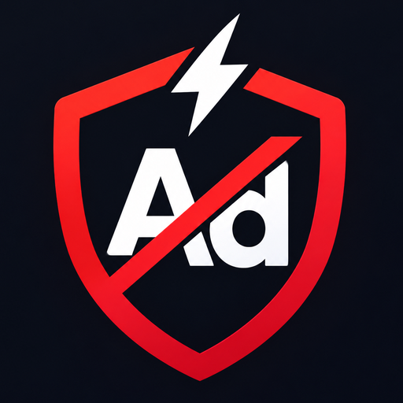

<div align="center">



# Blitz Ad Shield

**Fewer ads. More room for the game.**

A free, open-source ad blocker for the **Blitz.gg desktop app on Windows**. It blocks known ad requests, cleans up empty ad spaces, and runs quietly in your system tray.

[**⬇️ Download for Windows**](https://github.com/Morfildor/Blitz-Ad-Shield/raw/refs/heads/main/dist/Blitz-Ad-Shield-Tray-v0.7.0.zip) · [Installation](#installation) · [Report an issue](https://github.com/Morfildor/Blitz-Ad-Shield/issues)

<sub>Windows 10/11 · No subscription · No installer · MIT License</sub>

</div>

---

## Why I made this

I like using Blitz with League of Legends. I just don't like how much space its ads take up.

Blitz Ad Shield is a small tool I made to deal with that. Launch Blitz through it and carry on playing as usual, without having another window to manage.

## ✨ Features

- **Blocks ad requests.** Filters known advertising networks used by the Blitz desktop app, before each page and frame starts loading.
- **Cleans up the layout.** Hides empty ad containers so they don't take up space.
- **Private connection.** Shield controls Blitz over a private pipe, so no network debugging port is opened on your PC.
- **Light on your PC.** Only the few messages that matter are processed, so it stays out of the way while you play.
- **Stays in your system tray.** Start or stop protection, check its status, and open logs with a right-click.
- **Leaves game files alone.** No changes to Blitz's installed files, League of Legends, or Riot Vanguard.
- **Runs locally.** No account, subscription, administrator rights, or separate ad-blocking service needed.

## Installation

1. **[Download Blitz Ad Shield](https://github.com/Morfildor/Blitz-Ad-Shield/raw/refs/heads/main/dist/Blitz-Ad-Shield-Tray-v0.7.0.zip)** and extract the ZIP.
2. **Quit Blitz completely.** Make sure it's also closed in the Windows system tray.
3. Open the extracted folder and double-click **`Launch-Blitz-Ad-Shield.vbs`**.
4. Find the shield icon in your system tray. It might be tucked under the **^** hidden-icons menu.

That's it. Blitz launches with Ad Shield running in the background. You don't need to keep a command window open, just leave the shield running in your tray.

**Tray controls:** Right-click the shield icon for **Start protection**, **Stop protection**, **Check for updates**, **Open logs folder**, and **Exit Shield**. You can also turn **Restart Blitz after updates** on or off. The menu shows your installed version, update status, and last check time. If you stop or exit Shield while Blitz is open, Shield asks first, because Blitz then closes its window to the tray and ads come back until you restart it through Shield.

**Requirements:** Windows 10 or 11, Windows PowerShell 5.1, and the Blitz.gg desktop app.

<details>
<summary><strong>Alternative launch options</strong></summary>

If VBScript is disabled on your PC, launch `Run-Blitz-Ad-Shield.cmd` instead.

If Blitz is installed somewhere unusual, start `Blitz-Ad-Shield-Tray.ps1` in PowerShell with the custom executable path:

```powershell
.\Blitz-Ad-Shield-Tray.ps1 -BlitzPath "C:\path\to\Blitz.exe"
```

</details>

## 🔄 Automatic updates

Starting with **v0.4**, Ad Shield takes care of its own updates from this GitHub repository.

- **On launch:** Shield checks GitHub and installs any available update before starting Blitz.
- **While you're playing:** It checks again every six hours and downloads newer releases quietly.
- **After Blitz closes:** Shield installs the downloaded update and restarts its tray icon. From **v0.5.2**, it also reopens Blitz with ad blocking enabled, if **Restart Blitz after updates** is checked in the tray menu. The option is enabled by default and can be disabled anytime.
- **From the tray:** Choose **Check for updates** at any time. The menu shows **Up to date**, **Downloaded**, or **Check failed**, along with the most recent check time. A failed check never disables ad blocking.

Downloads come from this repository over HTTPS and are checked against a published **SHA-256 checksum**. If GitHub is unavailable or an update fails verification, Ad Shield continues using your current version. Previous files are backed up locally.

**Already using v0.5 or newer?** Your next update will install automatically after Blitz closes. With v0.5.2, Blitz can then relaunch automatically. Shield never force-closes Blitz or interrupts an active game. If Blitz keeps running in its own system tray, the update stays queued until it fully exits.

## ⚙️ How it works

Blitz Ad Shield launches Blitz and connects to it through the **Chromium DevTools Protocol (CDP)** over a **private pipe**, so no network port is opened. Each page and frame is paused for a moment while the block list and CSS are applied, then released, so ad requests don't slip through before the rules are in place. Shield filters selected advertising requests and applies CSS rules to hide known ad placeholders.

The [PowerShell blocker](Blitz-Ad-Shield.ps1) does the filtering, and the [tray controller](Blitz-Ad-Shield-Tray.ps1) manages it. Logs are saved to `%LOCALAPPDATA%\BlitzAdShield\Logs`.

It doesn't modify game files, change your DNS settings, or install a system-wide proxy.

**Advanced switches** for the blocker script (`Blitz-Ad-Shield.ps1`): `-UsePort` uses the older localhost debugging port instead of the pipe, `-LegacyAttach` turns off the brief page pause, `-NoCosmetic` skips hiding ad containers, and `-DebugLog` prints what Shield attaches to and blocks.

## Troubleshooting

**Blitz updated and Shield no longer connects?** Use **Check for updates** in the tray and review the logs. If Shield itself can't start, get the latest ZIP using the download link above. Blitz may restart itself once on its first launch after one of its own updates. If that happens, fully quit Blitz (including its tray icon) and start it through Shield again.

**Ads are back, or Blitz went to the tray on its own?** That means Shield stopped or lost its connection. Quit Blitz from its tray icon and start it through Shield. If Shield had to fall back to the localhost port, the log says so, and the port mode reconnects after short interruptions and reports the connection phase.

If Blitz doesn't start, make sure it's completely closed before launching Shield again. If the tray icon isn't visible, check the hidden-icons menu. If your PC blocks the VBScript launcher, use the CMD alternative above.

For other problems, open **Tray icon > Open logs folder** and check the latest `shield-...-errors.log` and `shield-....log`. [Report the problem](https://github.com/Morfildor/Blitz-Ad-Shield/issues) with your Windows and Blitz versions and the connection phase shown in the error. Remove private URLs or other sensitive details before sharing logs.

## A note about security

Shield talks to Blitz over a **private pipe** shared only between Shield and Blitz. It does **not** open a network debugging port, so other programs can't connect to Blitz through Shield.

**If Shield stops, Blitz isn't filtered anymore.** Closing the Shield tray app makes Blitz close its window to the system tray and keep running with ads back, so Shield asks before stopping while Blitz is open. Restart Blitz through Shield to block ads again. Future Blitz updates may also change how ad filtering behaves.

If the private pipe can't start on your PC, Shield falls back to the older localhost debugging port and says so in the log. You can also force that mode by adding `"connectionMode": "port"` to `%LOCALAPPDATA%\BlitzAdShield\settings.json`. While that port is open, other programs on your computer may be able to connect to it, so use it on a trusted PC and fully quit Blitz when you're done.

## Contributing

Found a bug or have an idea? Issues and pull requests are welcome. See [CONTRIBUTING.md](CONTRIBUTING.md), [SECURITY.md](SECURITY.md), and [LICENSE](LICENSE).

<sub>© 2026 Morfildor. Blitz Ad Shield is an independent community project, not affiliated with Blitz.gg or Riot Games. All trademarks belong to their respective owners.</sub>
